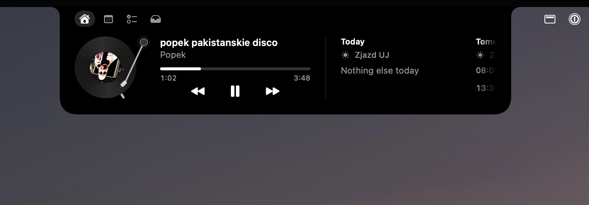

# Entailler

**The most elegant, slickest notch on macOS.** [Download the latest release](https://github.com/MaciejWiatr/entailler/releases/latest).

A personal macOS app that turns the MacBook's camera notch into an interactive surface for glanceable status, media, calendar, to-dos, and short-lived file handling. Every surface springs out of the camera cutout and tucks back in, content stays clipped to the Notch's shape, and the whole thing stays out of your way until it has something to say.



## What it does

**The Notch** shows Activities beside the camera cutout while it is collapsed:

- Flash Activities for volume and brightness changes, replacing the system pop-ups
- Now playing, from any app, with artwork and a waveform
- An upcoming event, counting down with a Join button for its call
- A Claude Code session waiting for you

**The Nook** opens when you rest the pointer on the Notch, or with ⌥⌘N. It has four views:

1. **Home**: the Media Widget and the Calendar Widget
2. **Calendar**: a month grid with each day's events
3. **To-Dos**: your Apple Reminders, kept in sync both ways
4. **Files**: the Tray, for parking files and dragging them out later, and an AirDrop Drop Zone

Dragging a file onto the Notch opens the Nook on Files. In the open Nook, ⌘1 to ⌘4 switch views, ⌘[ and ⌘] step through them, and Esc closes it.

Entailler lives in the menu bar with no Dock icon, and only draws on the built-in notched display.

## Requirements

- A MacBook with a notch, on macOS 26 or later
- Xcode 26 and [XcodeGen](https://github.com/yonaskolb/XcodeGen)

## Build and run

```sh
xcodegen generate
xcodebuild -project Entailler.xcodeproj -scheme Entailler -configuration Debug -derivedDataPath build build
open build/Build/Products/Debug/Entailler.app
```

The project signs with an Apple Development identity, so the Accessibility grant survives rebuilds. Change `DEVELOPMENT_TEAM` in `project.yml` to your own team first.

On first use, macOS asks for:

- **Accessibility**, to take over the volume and brightness keys
- **Calendars** and **Reminders**, for the Calendar Widget and To-Dos
- **System Audio Recording**, so the waveform follows what's playing
- **Automation**, to bring a Claude Code session's Terminal or iTerm2 tab to the front

## Tests

The app's behaviour lives in `Packages/NotchCore`, a pure Swift package tested with fakes:

```sh
cd Packages/NotchCore && swift test
```

## Project layout

| Path | What's there |
|---|---|
| `Packages/NotchCore` | The core: display state and every rule, with no AppKit or SwiftUI |
| `Entailler/Adapters` | The system behind protocols: EventKit, media, AirDrop, displays, and so on |
| `Entailler/Shell` | The SwiftUI and AppKit views and the Notch window |
| `Helpers/MediaRemote` | The helper that reads now playing from any app |
| `CONTEXT.md` | The project's vocabulary: Notch, Nook, Activity, Widget, Tray, Drop Zone |
| `docs/adr` | Architecture decisions, such as keeping private APIs behind adapters |
